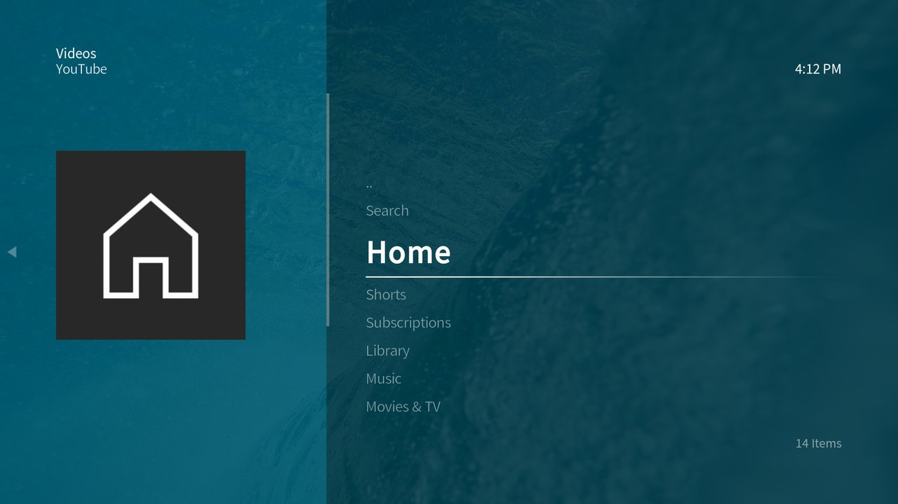
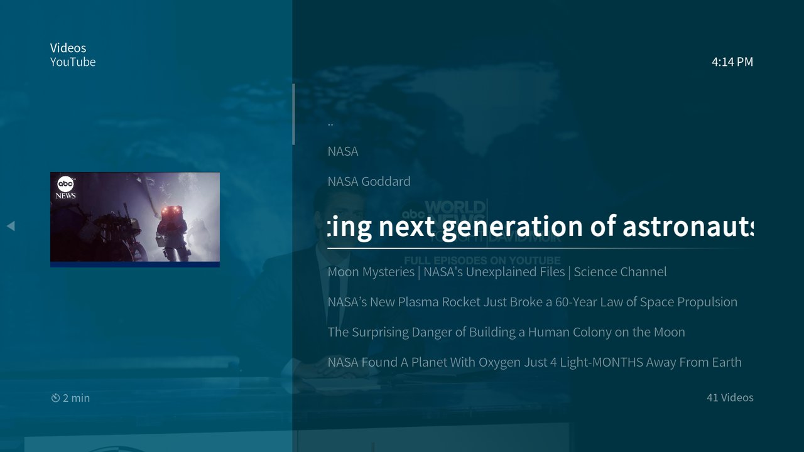
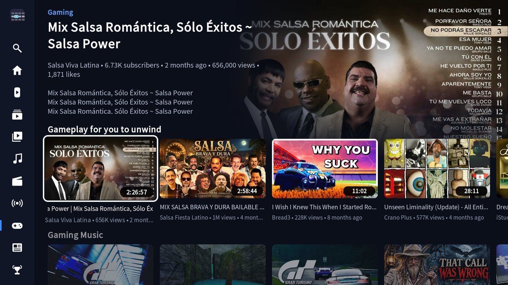
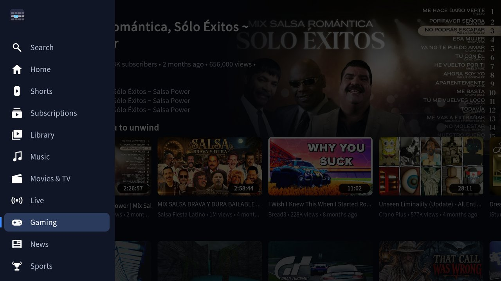
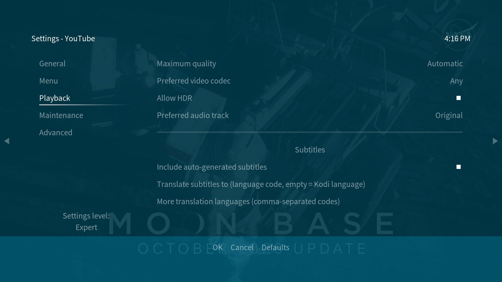

# YouTube (plugin.video.youtube)

A Kodi video add-on that browses YouTube with the TV layout: the TV sidebar, shelves,
subscriptions, library and search, full video information, and DASH/HLS playback through
InputStream Adaptive. It targets Kodi 21 (Omega) and later.

## Screenshots

| | |
|---|---|
|  |  |
| The main menu in Kodi's video window | Search results |
|  |  |
| The TV interface: the focused video's details over its channel art, with shelves below | The TV interface with its sidebar open |
|  | |
| Playback settings | |

## Features

- **Two ways to browse:** the add-on's folders in Kodi's own video window, using the skin's views,
  or the TV interface, a full-screen window laid out like the YouTube TV app.
- **Menus:** the TV guide entries (Search, Home, Shorts, Subscriptions, Library and topics),
  channel pages, playlists, related videos and paging.
- **Sign-in:** TV device code, with multiple accounts and an optional "Who's watching?" prompt.
- **Playback:** a DASH manifest built from direct stream URLs, HLS for live streams, captions
  plus auto-translated tracks, and the Shorts feed as a playlist.
- **Customisation:** show, hide or reorder main-menu items, pin channels, hide Shorts or
  watched videos, and set preferred quality, codec, HDR and audio track.

## Paths from earlier versions

The add-on also accepts the plugin paths earlier versions of plugin.video.youtube used, so existing
`.strm` files, favourites and keymaps keep working:

| Path | Opens |
|---|---|
| `/play/?video_id=ID` (`&seek=` or `&start=` seconds) | the video |
| `/play/?playlist_id=ID` (`&order=default\|reverse\|shuffle`, `&video_id=` first video) | the playlist, playing |
| `/channel/UC…/` | the channel |
| `/playlist/ID/`, `/channel/…/playlist/ID/` | the playlist |
| `/channel/mine/playlists/`, `/special/saved_playlists/` | your playlists |
| `/special/related_videos/?video_id=ID` | related videos |
| `/special/recommendations/` | Home |
| `/special/my_subscriptions/` | the Subscriptions feed |
| `/subscriptions/list/` | subscribed channels |
| `/search/?q=…`, `/kodion/search/query/?q=…` | search results |
| `/kodion/search/input/`, `/kodion/search/list/`, `/kodion/search/remove/?q=…` | new search, search history, remove a search |
| `/kodion/playback_history/` | your YouTube history |
| `/kodion/watch_later/list/` | Watch later |

## Development

```sh
pip install -r requirements-dev.txt
ruff check .
pytest
```

To build an installable zip for Kodi's **Install from zip file**:

```sh
python scripts/package.py
```

## License

GPL-3.0-only. See [LICENSE](LICENSE).
